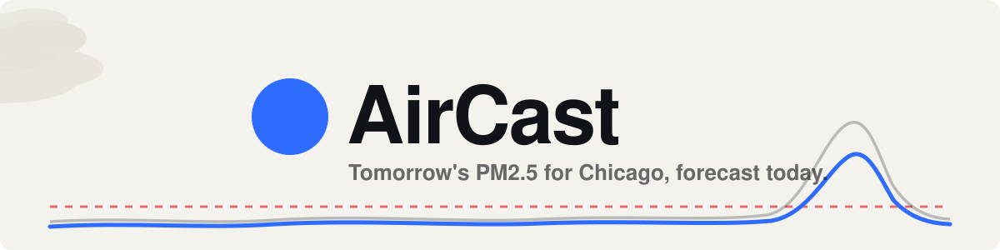

<picture>
  <source media="(prefers-color-scheme: dark)" srcset="assets/banner-dark.svg">
  
</picture>

<p align="center">
  
  
  
  
</p>

<p align="center">
  
</p>

**Track:** Climate
**Team:** Parth Patel and Anay Goyal, Emerson High School

## The problem

A school athletics director in Chicago has to decide today whether tomorrow's outdoor practice moves indoors. PM2.5, the pollutant that matters most for kids exercising outside, exceeds the WHO daily guideline about **1 day in 9** in Chicago, and during wildfire-smoke events the city has had some of the worst air in the world. Air-quality apps tell you what the air is like right now. The director needs tomorrow.

## What we built

The research model predicts **tomorrow's daily average PM2.5 at EPA monitors in Cook County**. It uses today's monitor readings, weather, and smoke signals: CAMS atmospheric-model estimates for Chicago and four cities upwind on the Canadian-smoke path (Minneapolis, Green Bay, Madison, Thunder Bay). An estimated 80% prediction interval drives two alerts. **WATCH** means the interval extends above the guideline. **WARNING** means the point forecast exceeds it. The no-key live demo in `src/predict_tomorrow.py` trains and forecasts against CAMS estimates. The EPA results below come from the notebook.

## What we added

Starting from the suggested next-day air-quality project:

1. Before trusting the brief's no-key data source (CAMS model estimates), we checked it against Chicago's real EPA monitors. It only correlates at **r = 0.67** and understated the worst day in our data almost 3× (50 vs 134 µg/m³). That check changed the whole project: we predict the monitors instead, and CAMS became just another input.
2. Our worst misses were all sudden smoke arrivals, which local data simply cannot see. Adding the upwind smoke signals cut error on those days from 21.8 (persistence) and 22.8 (local-only) to **17.9 µg/m³**.
3. We estimated 80% prediction intervals using 2024 validation residuals and observed 77% coverage in the 2025 test period. Our first alert design, tuned for 85% recall, turned out to need 234 alerts a year at 6% precision. We kept that failure in the notebook and derived the WATCH trigger from the interval.
4. A replay of the June 2023 smoke event with a frozen model, and a Milwaukee transfer test (both below).

## How it works

The dataset covers 1,197 consecutive days from August 4, 2022 through November 12, 2025. It combines EPA AQS daily files (Cook County and Milwaukee County monitor averages), Open-Meteo CAMS air quality, and historical weather. The 25 features cover monitor PM2.5 lags, weather, seasonality, and smoke signals. Ridge led five-fold time-series cross-validation (3.33 µg/m³ MAE vs. 3.53 for persistence). Training targets precede January 1, 2025. The test covers 315 forecasts issued January 1 through November 11, 2025. We used the local model's 2025 misses to design the smoke features, so the 2025 results for the enhanced model are exploratory.

## Results

Persistence baseline ("tomorrow = today"): **3.46 µg/m³ MAE** on the 2025 test year. AirCast: **3.11 µg/m³, 10% better**, growing to 20% at 2 days ahead and 25% at 3. On 2025's 34 bad days (>15 µg/m³): **WATCH caught 88%** (precision 48%); **WARNING caught 71% at 77% precision**; persistence managed 68%/68%.

**Where it fails.** In a replay trained on pre-June data, both AirCast and persistence missed the first smoke-day jump from 9 to 32 µg/m³. AirCast issued a warning for the peak day, forecasting 17 µg/m³ against a recorded 134 µg/m³. Extreme smoke events expose the limits of the available inputs. Follow live official advisories during these events. Chicago-trained weights also trailed Milwaukee's persistence baseline (3.65 vs. 3.60 µg/m³ MAE). Retraining the same pipeline in Milwaukee brought MAE down to 3.51 µg/m³.

## What we'd do next

Add NOAA's satellite smoke-plume maps as a feature, since that is exactly the gap we measured. Switch the live demo to EPA's AirNow feed (the official daily files publish on a delay, which is why the no-key demo runs on CAMS inputs). And recalibrate the intervals on a rolling window so coverage holds up in smoky years.

## Run it yourself

```bash
python -m pip install -r requirements.txt
jupyter notebook AirCast.ipynb                       # analysis using committed CSVs
python src/predict_tomorrow.py                       # live CAMS forecast (internet required)
python src/fetch_data.py && python src/fetch_epa.py    # optional: refresh data from public APIs
```

## Sources

- **Data:** [EPA Air Quality System daily summary files](https://aqs.epa.gov/aqsweb/airdata/download_files.html) (PM2.5, parameter 88101); [Open-Meteo Air Quality API](https://open-meteo.com/en/docs/air-quality-api) ([Copernicus CAMS](https://atmosphere.copernicus.eu/) model) and [Historical Weather API](https://open-meteo.com/en/docs/historical-weather-api), [CC BY 4.0](https://open-meteo.com/en/license).
- **Thresholds:** [WHO 2021 Global Air Quality Guidelines](https://www.who.int/publications/i/item/9789240034228) (15 µg/m³ daily); [US EPA 24-hour standard](https://www.epa.gov/pm-pollution) (35 µg/m³).
- **Libraries:** [pandas](https://pandas.pydata.org/), [scikit-learn](https://scikit-learn.org/), [matplotlib](https://matplotlib.org/), [requests](https://requests.readthedocs.io/), [Jupyter](https://jupyter.org/)/[jupytext](https://jupytext.readthedocs.io/).
- **AI tools:** [Claude Code](https://claude.com/claude-code) (Anthropic) was used as a coding assistant throughout: scaffolding the pipeline, writing and debugging code, and drafting this write-up, with the team directing the project and reviewing the work.
